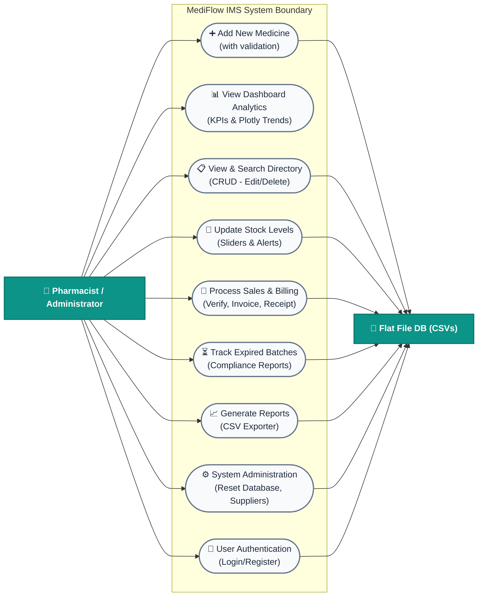
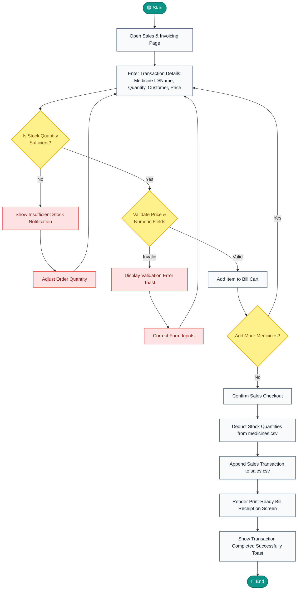
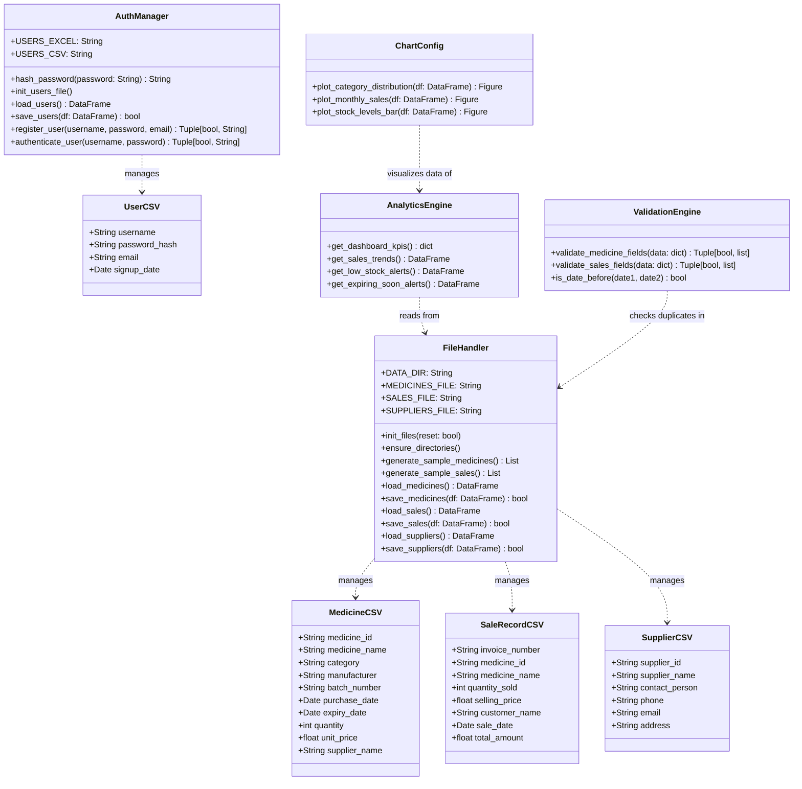
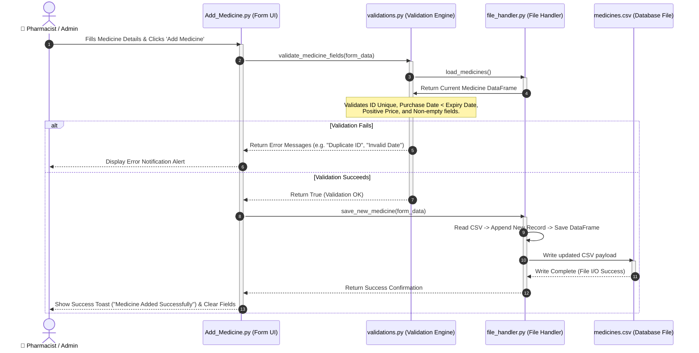

```mermaid
graph TB
    subgraph UI_Layer ["🎨 User Interface Layer (Streamlit Pages)"]
        App["app.py (Main Router / Auth Portal)"]
        Dashboard["Dashboard.py (KPIs & Metrics)"]
        ViewMeds["View_Medicines.py (Inventory Directory & CRUD)"]
        AddMed["Add_Medicine.py (Medicine Registration)"]
        UpdateStock["Update_Stock.py (Stock Adjustments)"]
        Sales["Sales.py (Invoicing & Checkout)"]
        Expiry["Expiry_Tracker.py (Compliance Audits)"]
        Reports["Reports.py (Excel/CSV Export Hub)"]
        Settings["Settings.py (DB Admin & Supplier Panel)"]
    end

    subgraph Business_Logic ["⚙️ Utilities / Business Logic Layer"]
        auth["auth.py (SHA-256 Auth Controller)"]
        validations["validations.py (Form Validations)"]
        analytics["analytics.py (KPI Math Calculators)"]
        charts["charts.py (Plotly Charts Engine)"]
        helper["helper.py (Theme Switcher & Notification Checker)"]
        file_handler["file_handler.py (File Serialization Handler)"]
    end

    subgraph Data_Layer ["💾 Database Layer (Flat-Files)"]
        medicines["medicines.csv"]
        sales_data["sales.csv"]
        suppliers["suppliers.csv"]
        users["users.csv / users.xlsx"]
    end

    subgraph Assets_Layer ["💅 Assets Layer"]
        styles["styles.css (Tailored CSS Rules)"]
        logo["logo.png (Brand Medical Icon)"]
    end

    %% UI to Business Logic relations
    App --> auth
    App --> helper
    Dashboard --> analytics
    Dashboard --> charts
    ViewMeds --> file_handler
    AddMed --> validations
    AddMed --> file_handler
    UpdateStock --> file_handler
    Sales --> file_handler
    Sales --> validations
    Expiry --> file_handler
    Reports --> file_handler
    Settings --> file_handler
    
    %% UI to assets
    App --> styles
    App --> logo

    %% Business Logic to Data Layer
    file_handler --> medicines
    file_handler --> sales_data
    file_handler --> suppliers
    auth --> users

    classDef ui fill:#e0f2fe,stroke:#0284c7,stroke-width:1.5px,color:#0369a1;
    classDef logic fill:#ecfdf5,stroke:#059669,stroke-width:1.5px,color:#047857;
    classDef db fill:#fef3c7,stroke:#d97706,stroke-width:1.5px,color:#b45309;
    classDef asset fill:#faf5ff,stroke:#9333ea,stroke-width:1.5px,color:#7e22ce;

    class App,Dashboard,ViewMeds,AddMed,UpdateStock,Sales,Expiry,Reports,Settings ui;
    class auth,validations,analytics,charts,helper,file_handler logic;
    class medicines,sales_data,suppliers,users db;
    class styles,logo asset;
```

# MediFlow IMS - UML Diagrams Catalog

This catalog contains six standard UML diagrams describing the architecture, workflows, structure, and execution environment of **MediFlow IMS (Medical Store Inventory System)**. 

All diagrams are written in **Mermaid syntax** and will render natively in supported Markdown previewers (like VS Code, GitHub, Obsidian). You can easily export them to high-resolution images or vector graphics to include in your **Mini Project PowerPoint (PPT)** presentation.

---

## 📋 Table of Contents
1. [Use-Case Diagram](#1-use-case-diagram)
2. [Activity Diagram (Sales Transaction Flow)](#2-activity-diagram-sales-transaction-flow)
3. [Class Diagram](#3-class-diagram)
4. [Component Diagram](#4-component-diagram)
5. [Sequence Diagram (Adding a New Medicine)](#5-sequence-diagram-adding-a-new-medicine)
6. [Deployment Diagram](#6-deployment-diagram)
7. [🖥️ How to Convert Diagrams and Text into a PowerPoint Presentation](#%EF%B8%8F-how-to-convert-diagrams-and-text-into-a-powerpoint-presentation)

---

## 1. Use-Case Diagram

The Use-Case Diagram represents the functional scope of MediFlow IMS from the perspective of the system's primary user (Pharmacist/Administrator) and the secondary system component (the CSV database).

### Mermaid Diagram



### 📝 PPT Slide Notes
- **Title**: Use-Case Diagram: System Boundaries and Actor Interactions
- **Primary Actor**: **Pharmacist / Administrator** interacts with the graphical interface to perform inventory tasks, process bills, and download records.
- **Secondary Actor**: **Flat-File CSV Database System** handles storage operations, ensuring read/write commands trigger dynamically.
- **Key Relationships**: System restricts unauthorized users via the **User Authentication** module. Once logged in, the pharmacist runs core transactional operations which write directly to the CSV files.

---

## 2. Activity Diagram (Sales Transaction Flow)

This diagram tracks the behavioral control flow within the **Sales & Invoicing Module** (`Sales.py`). It highlights validation checkpoints, error states, database writes, and billing updates.

### Mermaid Diagram



### 📝 PPT Slide Notes
- **Title**: Activity Diagram: Sales & Billing Workflow
- **Workflow Highlights**:
  - **Stock Check Validation**: Automatically verifies stock volumes in real-time before checkout. If requested levels exceed inventory margins, the transaction is halted.
  - **Data Integrity**: Checks numeric boundaries (e.g., negative prices/quantities) before checkout confirmation.
  - **Atomic DB Update**: Deducts inventory levels from `medicines.csv` and records receipt summaries to `sales.csv` in sequence.

---

## 3. Class Diagram

This Class Diagram details the structural code design. Although Streamlit is script-based, this diagram models the system's logical utility modules, analytical services, and CSV-schema representation fields as classes.

### Mermaid Diagram



### 📝 PPT Slide Notes
- **Title**: Class Diagram: Logical Component and Data Model Layout
- **Architectural Separation**:
  - **Data Models**: Represent the tabular columns stored in CSV/Excel sheets (`MedicineCSV`, `SaleRecordCSV`, `SupplierCSV`, `UserCSV`).
  - **Utility Managers**: `FileHandler` coordinates Pandas-based CSV serialization. `AuthManager` handles password hashing and session validations.
  - **Analytical Controllers**: `AnalyticsEngine` filters datasets to compute trends and KPIs. `ChartConfig` generates Plotly visualizations.

---

## 4. Component Diagram

The Component Diagram displays the high-level physical layout of the application. It highlights dependencies between UI elements, underlying utility layers, brand assets, and CSV files.

### Mermaid Diagram



### 📝 PPT Slide Notes
- **Title**: Component Diagram: Application Layers and Dependencies
- **Layer Details**:
  - **UI Layer**: Streamlit pages serving as interactive panels. `app.py` acts as the entrypoint and routing kernel.
  - **Business Logic**: Standalone reusable Python modules dealing with system state, charts, calculations, and inputs.
  - **Data Storage**: A secure sub-folder holding static files (`.csv`, `.xlsx`).
  - **Assets**: CSS stylesheet containing custom theme adjustments, fonts, card layouts, and branding graphics.

---

## 5. Sequence Diagram (Adding a New Medicine)

This Sequence Diagram depicts step-by-step object interactions during the medicine registration workflow, highlighting validation checks, ID checks, file inputs, and UI notifications.

### Mermaid Diagram



### 📝 PPT Slide Notes
- **Title**: Sequence Diagram: Medicine Registration and Validation Flow
- **Execution Flow**:
  1. **User Action**: The pharmacist inputs data and submits the register form.
  2. **Validation Stage**: The UI delegates verification to `validations.py` which loads current records via `file_handler.py` to prevent duplicate IDs.
  3. **Alternative Routes**:
     - *Validation Failure*: Displays appropriate inline toast/alert messages and cancels the write action.
     - *Validation Success*: Appends the object record to the DataFrame and commits it to `medicines.csv` on-disk.
  4. **Feedback loop**: The UI updates, showing a confirmation banner, and resets input components.

---

## 6. Deployment Diagram

This Deployment Diagram illustrates the runtime environment, detailing the local client-server execution model.

### Mermaid Diagram

```mermaid
graph TB
    subgraph Client_Node ["🖥️ Client Node (User's Machine)"]
        Browser["🌐 Web Browser<br>(Chrome, Edge, Firefox)"]
        BrowserUI["React-based UI Client<br>(HTML/CSS/JS DOM)"]
        Browser --> BrowserUI
    end

    subgraph Server_Node ["🐍 Python Application Server (Localhost)"]
        Streamlit["⚙️ Streamlit Web Server Daemon<br>(Runs on Port 8501)"]
        AppRuntime["🚀 MediFlow App Execution Runtime<br>(Python 3.8+)"]
        Modules["📂 utils/ Packages<br>(file_handler, auth, analytics)"]
        
        Streamlit --> AppRuntime
        AppRuntime --> Modules
    end

    subgraph Storage_Node ["💾 Storage Device (Local File System)"]
        CSVFiles["📁 data/ Directory<br>(medicines.csv, sales.csv, suppliers.csv)"]
    end

    %% Communications
    BrowserUI <-->|HTTP / WebSockets<br>Port 8501| Streamlit
    Modules <-->|Local OS File System I/O<br>(Pandas read/write APIs)| CSVFiles

    classDef client fill:#f0f9ff,stroke:#0369a1,stroke-width:2px,color:#0369a1;
    classDef server fill:#f0fdf4,stroke:#15803d,stroke-width:2px,color:#15803d;
    classDef storage fill:#fff7ed,stroke:#c2410c,stroke-width:2px,color:#c2410c;

    class Client_Node,Browser,BrowserUI client;
    class Server_Node,Streamlit,AppRuntime,Modules server;
    class Storage_Node,CSVFiles storage;
```

### 📝 PPT Slide Notes
- **Title**: Deployment Diagram: Localhost Client-Server Execution Architecture
- **Hardware/Node Details**:
  - **Client Machine**: The terminal user operates any modern web browser accessing the local port.
  - **Application Server (Localhost)**: A Python virtual environment running Streamlit. It compiles Python scripts into a reactive web structure rendered dynamically on the browser.
  - **Storage Device**: Represents the local disk where files under `/data` are accessed by Pandas inside the application loop.
- **Protocols**: Websockets (WS) and HTTP protocol (Port 8501) are used for server-client sync, and direct OS storage operations (Local File System I/O) are used for database operations.

---

## 🖥️ How to Convert Diagrams and Text into a PowerPoint Presentation

You can use the following methods to convert the content in this file into PPT slides for your mini-project presentation.

### Method 1: Exporting Mermaid Diagrams as Images (Recommended & Easiest)
You can convert these Mermaid diagrams to high-quality PNG or SVG images and insert them directly into standard PowerPoint slides:

1. **Open the Mermaid Live Editor**:
   - Go to [mermaid.live](https://mermaid.live/) in your web browser.
2. **Copy and Paste the Diagram Code**:
   - Copy any of the Mermaid code blocks from above (only the code inside the ` ```mermaid ` indicators).
   - Paste it into the "Code" panel on the left side of the Mermaid Live Editor page.
3. **Download the Image**:
   - The right side will render the live diagram.
   - Click the **Actions** tab on the bottom-left panel.
   - Choose **PNG** or **SVG** (vector format, ideal for resizing without pixelation).
   - Save the file to your computer.
4. **Insert into PowerPoint**:
   - In PowerPoint, create a new slide with a layout suited for diagrams (e.g., "Title and Content" or a blank slide).
   - Go to **Insert > Pictures > This Device** and select the downloaded diagram.
   - Copy and paste the corresponding **PPT Slide Notes** (provided above) into the PowerPoint presentation notes panel to help you during your viva-voce!

---

### Method 2: Convert directly to PPT using Marp (VS Code Extension)
If you want to compile this Markdown file directly into a styled, professional PowerPoint presentation (`.pptx` file):

1. **Install VS Code Extension**:
   - Search for and install the extension **Marp for VS Code** in the Extensions Marketplace (Ctrl+Shift+X).
2. **Enable HTML and Preview**:
   - Open this `uml_diagrams.md` file.
   - Click the Marp icon at the top of the editor or open the VS Code Command Palette (`Ctrl+Shift+P`) and type `Marp: Toggle Marp feature for current Markdown`.
3. **Format as Slides (Optional Adjustment)**:
   - Marp uses `---` dividers to split slides. We have already structured this file logically.
4. **Export to PPTX**:
   - Click the Marp icon on the VS Code editor menu (or press `Ctrl+Shift+P` -> type `Marp: Export Slide Deck...`).
   - Choose the file format: **PowerPoint document (*.pptx)**.
   - Click **Save**.
   - Your slides will be generated instantly, with text formatting and images compiled automatically!
